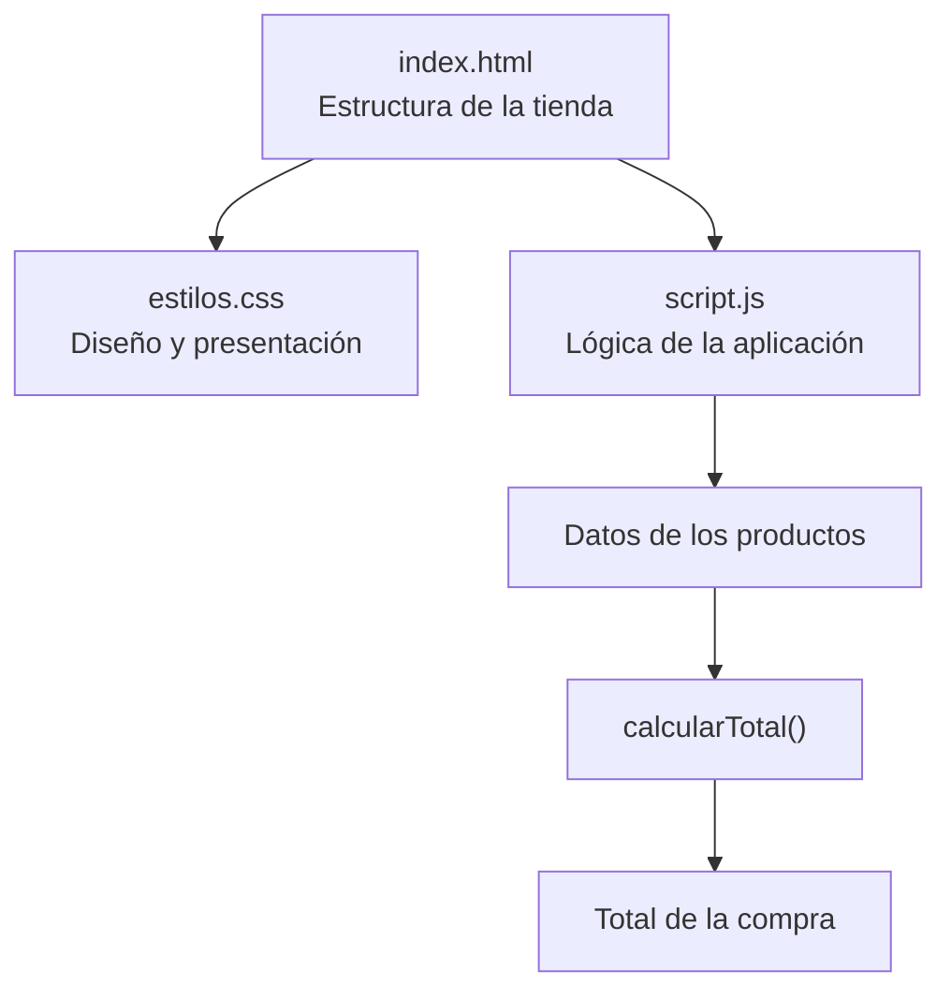

# Tienda TECSUP

<p align="center">
  
  
  
</p>

**Tienda TECSUP** es un proyecto académico desarrollado para practicar la creación de interfaces web utilizando HTML, CSS y JavaScript.

La aplicación presenta una pequeña tienda de productos TECSUP y calcula automáticamente el importe total de acuerdo con los precios y las cantidades seleccionadas.

---

## Tabla de contenidos

- [Descripción del proyecto](#descripción-del-proyecto)
- [Tecnologías utilizadas](#tecnologías-utilizadas)
- [Instalación](#instalación)
- [Uso](#uso)
- [Arquitectura del proyecto](#arquitectura-del-proyecto)
- [Estado del proyecto](#estado-del-proyecto)
- [Hoja de ruta](#hoja-de-ruta)
- [Contribuciones](#contribuciones)
- [Licencia](#licencia)

## Descripción del proyecto

Tienda TECSUP es una aplicación web sencilla que simula una tienda de productos institucionales. Su objetivo es mostrar información de productos, precios y cantidades, además de calcular automáticamente el importe total de la compra.

El proyecto permite practicar conceptos fundamentales del desarrollo frontend y la manipulación de datos mediante JavaScript.

## Tecnologías utilizadas

| Tecnología | Función dentro del proyecto                     |
| :--------- | :---------------------------------------------- |
| HTML5      | Estructura y contenido de la página web.        |
| CSS3       | Diseño, estilos y presentación visual.          |
| JavaScript | Procesamiento de productos y cálculo del total. |
| Git        | Control de versiones del proyecto.              |
| GitHub     | Almacenamiento y publicación del código fuente. |

## Instalación

El proyecto no requiere instalar dependencias ni configurar un servidor. Para obtener una copia local, se puede clonar el repositorio:

```bash
git clone https://github.com/omarcruzv-gif/tienda-tecsup.git
```

Una vez descargado, se puede abrir el archivo `index.html` directamente en un navegador web.

## Uso

La aplicación presenta una tabla con los productos disponibles, sus precios y cantidades. JavaScript procesa los datos y calcula el importe total considerando el precio unitario y la cantidad de cada producto.

La estructura principal de la página utiliza HTML:

```html
<table>
    <tr>
        <th>Producto</th>
        <th>Precio</th>
        <th>Cantidad</th>
    </tr>
</table>
```

El cálculo del importe total se realiza mediante JavaScript:

```javascript
function calcularTotal(lista) {
    let total = 0;

    for (let producto of lista) {
        total += producto.precio * producto.cantidad;
    }

    return total;
}
```
## Arquitectura del proyecto

La aplicación está organizada en tres archivos principales, cada uno con una responsabilidad específica:



### Estructura de archivos

```text
tienda-tecsup/
│
├── index.html
├── estilos.css
├── script.js
├── README.md
└── CONTRIBUTING.md
```